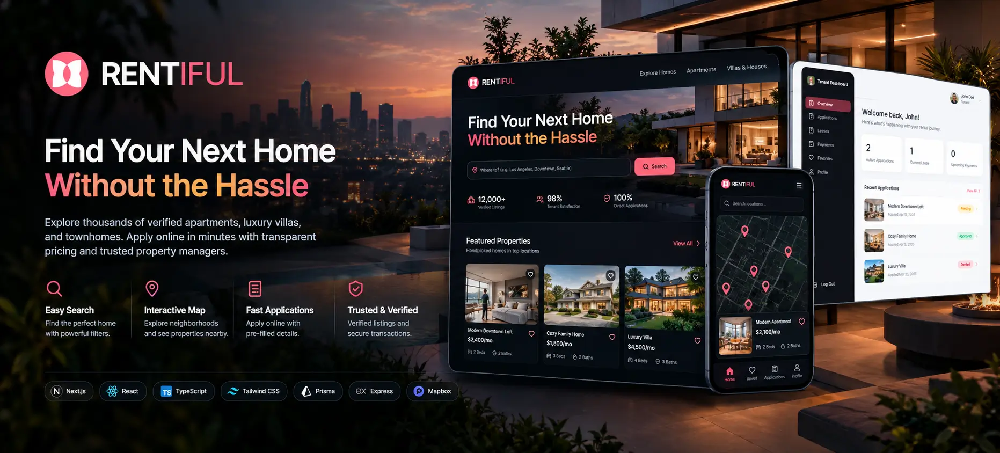

<div align="center">

# 🏡 Rentiful — Modern Real Estate & Rental Management Platform

<p align="center"></p>

[](https://nextjs.org/)
[](https://react.dev/)
[](https://motion.dev/)
[](https://www.typescriptlang.org/)
[](https://zod.dev/)
[](https://tanstack.com/query/)
[](https://tailwindcss.com/)
[](https://www.prisma.io/)
[](https://expressjs.com/)
[](https://nodejs.org/)
[](https://ui.shadcn.com/)
[](https://www.docker.com/)
[](https://nginx.org/)
[](https://aws.amazon.com/)
[](https://www.mapbox.com/)

**Rentiful** is a full-stack real estate marketplace and rental management platform inspired by modern hospitality and booking experiences like Airbnb. It connects prospective tenants with verified property managers through real-time interactive mapping, direct digital lease applications, instant favoriting, and dedicated tenant/manager dashboards.

---

</div>

## ✨ Key Features

### 🔍 For Renters & Tenants

- **Cinematic Discovery & Landing Experience**: High-impact hero search, verified property highlights, curated neighborhood collections, and live metrics.
- **Interactive Map Search**: Split-screen listing and Mapbox GL view with synchronized hover highlights, geocoded markers, and dynamic bounding box filtering.
- **Multi-Image Property Carousels**: Smooth image previews powered by Embla Carousel directly on listing cards.
- **Direct Application Submissions**: Apply to homes with pre-filled profile data, custom notes, phone validation, and real-time status tracking (`Pending`, `Approved`, `Denied`).
- **Personalized Tenant Portal**: View submitted applications, active leases, payment schedules, and saved favorite properties.
- **Multi-Theme Engine**: 3 custom theme palettes (Modern Dark, Crisp Light, and Warm Sand) with seamless system preference synchronization.

### 🏢 For Property Managers

- **Property Management Dashboard**: Create, edit, and monitor properties with custom amenities, image uploads, price configurations, and location coordinates.
- **Tenant Application Processing**: Accept or reject tenant applications with automated lease creation and deposit tracking.
- **Financial & Lease Tracking**: Real-time lease term overviews, upcoming payment calculations, and tenant details.

---

## 🛠️ Architecture & Tech Stack

### **Frontend**

- **Framework**: [Next.js 16 (App Router)](https://nextjs.org/)
- **UI Components**: [Base UI](https://base-ui.com/) + Custom Tailwind CSS Design System
- **State & Server Cache**: [TanStack Query v5](https://tanstack.com/query) + [Zustand](https://zustand-demo.pmnd.rs/)
- **Animations & Transitions**: [Framer Motion](https://www.framer.com/motion/)
- **Form Management**: [React Hook Form](https://react-hook-form.com/) + [Zod Validation](https://zod.dev/)
- **Mapping**: [Mapbox GL JS](https://www.mapbox.com/)
- **Carousels**: [Embla Carousel React](https://www.embla-carousel.com/)
- **Theming**: [Next Themes](https://github.com/pacocoursey/next-themes)

### **Backend**

- **Runtime**: [Node.js](https://nodejs.org/) / [Bun](https://bun.sh/) with TypeScript
- **Server Framework**: [Express.js](https://expressjs.com/)
- **Database & ORM**: PostgreSQL with [Prisma ORM](https://www.prisma.io/)
- **Authentication**: AWS Cognito JWT validation & role-based middleware (`tenant` | `manager`)
- **File & Media Handling**: Multi-part uploads with AWS S3 / CloudFront integration

---

## 📁 Repository Structure

```plaintext
real-estate/
├── frontend/                     # Next.js App Router Client
│   ├── app/
│   │   ├── (auth)/              # Sign in / Sign up authentication pages
│   │   ├── (dashboard)/         # Protected Tenant & Manager dashboards
│   │   ├── (public)/            # Landing, Search, and Listing detail pages
│   │   ├── sitemap.ts           # Dynamic SEO sitemap generator
│   │   └── globals.css          # Design tokens & color theme palettes
│   ├── api/                     # TanStack Query hooks & Axios requests
│   ├── components/              # UI components (PropertyCard, Navbar, Footer, etc.)
│   ├── lib/                     # Utilities, schemas, constants & Mapbox helpers
│   └── store/                   # Zustand client state stores (filters, favorites)
│
├── backend/                      # Express REST API Server
│   ├── prisma/                  # Database schema, migrations & seed scripts
│   │   └── schema.prisma
│   └── src/
│       ├── controllers/         # Property, Application, Lease, Manager controllers
│       ├── middleware/          # Auth, role validation & error handlers
│       ├── routes/              # Express API route endpoints
│       └── lib/                 # Prisma DB client & app utilities
└── README.md
```

---

## 🚀 Getting Started

### Prerequisites

- [Node.js 18+](https://nodejs.org/) or [Bun](https://bun.sh/)
- [PostgreSQL](https://www.postgresql.org/) database instance
- [Mapbox Access Token](https://account.mapbox.com/)
- [AWS Cognito User Pool](https://aws.amazon.com/cognito/) (for authentication)

---

### 1. Clone the Repository

```bash
git clone https://github.com/Steve-madlad/real-estate.git
cd real-estate
```

---

### 2. Backend setup

From `backend/`, install dependencies and create `backend/.env` with the real runtime configuration, including `DATABASE_URL`, `PORT=3001`, Cognito settings, and AWS settings required by the features you use. The database must be reachable from the backend and have PostGIS available.

```sh
cd backend
npm ci
npm run prisma:gen
npm run dev
```

Run `npm run prisma:mgt` to create/apply a development migration, `npm run prisma:mgt:dep` to apply committed migrations, and `npm run seed` to load seed data.

### 3. Frontend setup

From `frontend/`, install dependencies and create `.env.local` with the public settings below. For local development, the backend API listens on port `3001`.

```env
NEXT_PUBLIC_API_BASE_URL="http://localhost:3001"
NEXT_PUBLIC_MAPBOX_TOKEN="your-public-mapbox-token"
NEXT_PUBLIC_COGNITO_USER_POOL_ID="your-user-pool-id"
NEXT_PUBLIC_COGNITO_USER_POOL_CLIENT_ID="your-user-pool-client-id"
```

```sh
cd frontend
npm ci
npm run dev
```

Open <http://localhost:3000>. Frontend public values are embedded during builds; update the build environment and rebuild when they change. The Prisma schema also generates frontend model types; see [frontend/README.md](./frontend/README.md).

---

## Containerized deployment

The current `compose.yaml` runs three services: Nginx, the Next.js frontend, and the Express backend. Nginx is the only published service (`http://localhost`, port `80`); it sends `/api/` requests to `backend:3001` and all other requests to `frontend:3000`. Nginx applies a per-client request limit to API traffic. The frontend and backend ports are exposed only on the Compose network. The Compose setup does not include PostgreSQL.

Compose expects these images to exist before startup:

- `real-estate-frontend:${IMAGE_TAG:-latest}`
- `real-estate-backend:${IMAGE_TAG:-latest}`
- Nginx is built locally from `nginx/Dockerfile`.

The frontend/backend `build` blocks in `compose.yaml` are intentionally commented out. CI/CD is configured to build and publish application images; make the matching image tag available locally (or set `IMAGE_TAG` to the deployed tag) before running `docker compose up -d`. Configure runtime backend variables in `backend/.env` before starting Compose. The backend needs a real `DATABASE_URL` reachable from its container; Compose does not provision a database.

Frontend `NEXT_PUBLIC_*` configuration is consumed at image build time and embedded in the browser bundle: `NEXT_PUBLIC_API_BASE_URL`, `NEXT_PUBLIC_COGNITO_USER_POOL_ID`, `NEXT_PUBLIC_COGNITO_USER_POOL_CLIENT_ID`, and `NEXT_PUBLIC_MAPBOX_TOKEN`. These values must be supplied to the CI build as build arguments. For a local build, uncomment the frontend `build` block in Compose and pass the four values from the host environment, or use `frontend/Dockerfile.standalone` directly. The API URL must be reachable by the user's browser. Local use through Nginx can use `http://localhost/api`; direct access to the backend from the host requires publishing its port explicitly.

The backend Docker build requires BuildKit and a build-time `DATABASE_URL` secret for `prisma generate`. This can be a dummy PostgreSQL URL because client generation does not connect to the database. It is separate from the real runtime URL in `backend/.env`; do not bake runtime credentials into the image. The schema generates Prisma clients for both backend and frontend, so regenerate via `backend`'s `npm run prisma:gen` after schema changes.

Start the already-built images and Nginx with:

```sh
docker compose up -d
```

To build locally, enable the commented image build sections in `compose.yaml`; the backend section already describes the BuildKit secret and frontend section the public build arguments. Then run `docker compose up --build`. Stop the stack with `docker compose down`. `docker compose watch` uses the configured source and Dockerfile watchers.

The canonical production URL is maintained in `frontend/lib/constants.ts` (`appPublicUrl`). Update it if the public URL changes. For frontend and backend Docker details, see [frontend/README.Docker.md](./frontend/README.Docker.md) and [backend/README.Docker.md](./backend/README.Docker.md).

## 📡 Key API Routes

| Method | Route                                | Access           | Description                                               |
| :----- | :----------------------------------- | :--------------- | :-------------------------------------------------------- |
| `GET`  | `/properties`                        | Public           | Search and filter properties with query params            |
| `GET`  | `/properties/:id`                    | Public           | Retrieve individual property specifications & coordinates |
| `POST` | `/properties`                        | Manager          | Create new listing with amenities & specs                 |
| `GET`  | `/applications`                      | Tenant / Manager | List user-specific rental applications                    |
| `GET`  | `/applications/property/:propertyId` | Tenant / Manager | List applications for a specific listing                  |
| `POST` | `/applications`                      | Tenant           | Submit a new digital rental application                   |
| `PUT`  | `/applications/:id/process`          | Manager          | Approve or deny an application & generate lease           |
| `GET`  | `/leases`                            | Tenant / Manager | Fetch active leases and payment schedules                 |

---

## 🎨 Theme Customization

Rentiful includes a 3-tier theme system configured via CSS variables in `frontend/app/globals.css`:

- **Dark Mode (`dark`)**: Slate & Zinc deep tones with vibrant coral/rose highlights.
- **Light Mode (`light`)**: Clean, minimalist white backdrop with high-contrast typography.
- **Warm Sand (`theme-warm`)**: Earthy cream and amber palette for a warm editorial look.

Toggle themes dynamically from the navigation bar menu.

---

## 📄 License

This project is licensed under the MIT License.
